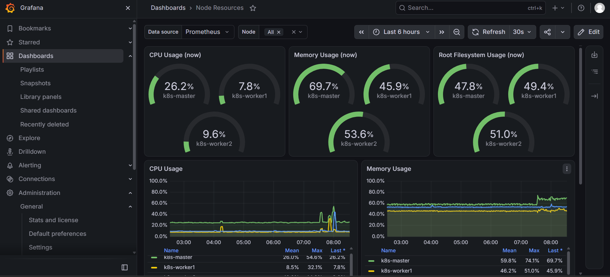
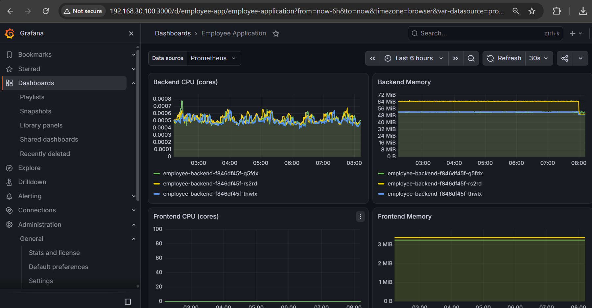
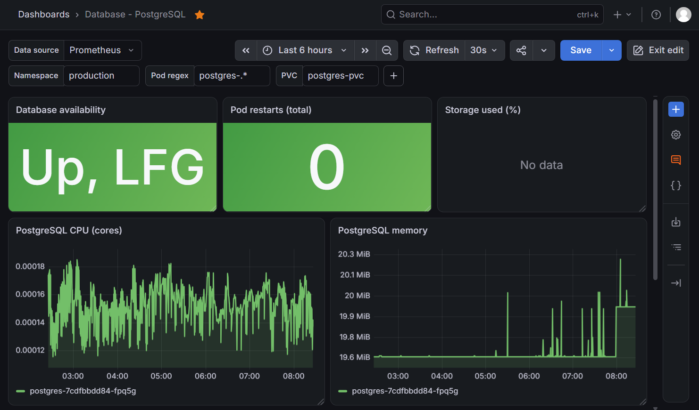
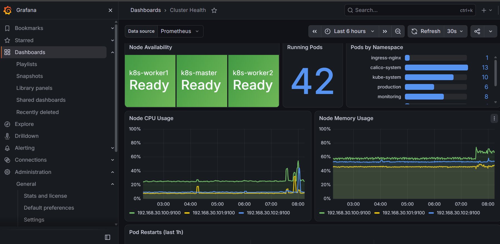

## Kubernetes Improvements and Production Readiness

## Overview

I built on my existing Employee Directory Kubernetes project. In the previous stage, I deployed the application to a Kubernetes cluster using `kubeadm`, with dedicated control-plane and worker VMs.

This update focuses on improving how the application is exposed, monitored, secured, and managed within the cluster.

## Existing Lab Environment

The project continues to use my existing homelab infrastructure.

| Component | Description |
|---|---|
| Virtualization | Proxmox |
| Network and firewall | pfSense |
| Kubernetes setup | kubeadm |
| Control plane | `k8s-master` |
| Worker nodes | `k8s-worker1`, `k8s-worker2` |
| Application namespace | `production` |
| Application | Employee Directory |
| Database | PostgreSQL |
| Persistent storage | PersistentVolumeClaim (PVC) |
| Application workloads | Frontend, backend, and PostgreSQL |

The Kubernetes cluster runs on dedicated virtual machines, separate from the original Docker-based application environment.

## What I Added and Improved

### 1. Application Routing

I extended the application's networking configuration to learn how external HTTP traffic reaches services inside Kubernetes.

The routing architecture is designed around a gateway and route resources, directing requests to the appropriate internal Service.

The intended request flow is:

```text
Browser
   |
   v
Gateway / HTTPRoute
   |
   +----------------------+
   |                      |
   v                      v
Frontend Service     Backend Service
   |                      |
   v                      v
Frontend Pods         Backend Pods
                          |
                          v
                   PostgreSQL Service
                          |
                          v
                    PostgreSQL Pod
```

This separates external access from internal application communication.

The frontend is the user-facing component, while the backend and database are intended to remain internal to the cluster.

### 2. Metrics Server and Resource Monitoring

I explored K8s resource monitoring using Metrics Server.

Metrics Server collects CPU and memory usage from Kubernetes nodes and workloads and exposes resource metrics through the Kubernetes Metrics API.

Commands used to inspect resource consumption include:

```bash
kubectl top nodes
kubectl top pods -n production
```

These commands help identify resource usage across the cluster and individual application Pods.

### 3. Resource Requests and Limits

I worked on defining resource requests and limits for application containers.

Example:

```yaml
resources:
  requests:
    cpu: "250m"
    memory: "256Mi"
  limits:
    cpu: "500m"
    memory: "512Mi"
```

These values are illustrative lab settings and should be adjusted based on observed application usage.


### 4. Health Probes

I continued improving application health checks using Kubernetes probes.

The three probe types serve different purposes:

| Probe | Purpose |
|---|---|
| Startup | Determines whether the application has started successfully. |
| Readiness | Determines whether the Pod should receive traffic. |
| Liveness | Determines whether the container should be restarted because it is unhealthy. |

These checks help Kubernetes respond to unhealthy application instances and avoid sending normal Service traffic to Pods that are not ready.

### 5. Horizontal Scaling and Rolling Updates

I explored scaling application workloads and managing Deployment updates.

Manual scaling example:

```bash
kubectl scale deployment employee-backend \
  --replicas=5 \
  -n production
```

Inspect the resulting Pods:

```bash
kubectl get pods -n production
```

To monitor an update:

```bash
kubectl rollout status deployment/employee-backend \
  -n production
```


These exercises demonstrate how Deployments manage replicas and provide controlled application updates.

I also explored Horizontal Pod Autoscaling as a way to adjust replica counts based on load on the server.

### 6. Prometheus and Grafana

I expanded my observability learning using Prometheus and Grafana.

Prometheus collects and stores time-series metrics from configured targets. Grafana queries monitoring data and presents it through dashboards.

The monitoring architecture is:

```text
Kubernetes Cluster
        |
        v
    Prometheus
        |
        v
      Grafana
        |
        v
 Dashboards and Analysis
```

The monitoring goals include observing:

- Node CPU and memory usage.


- Application Pod resource consumption.


- PostgreSQL container resource usage.


- Overall cluster resource utilization.


- Pod restarts and workload health.

Metrics Server and Prometheus serve different purposes: Metrics Server provides resource metrics for Kubernetes operations, while Prometheus supports broader monitoring, historical analysis, queries, and alerting.

### 7. Role-Based Access Control (RBAC)

I explored Kubernetes RBAC to understand how permissions can be restricted according to a user's or service identity's responsibilities.

The main resources studied include:

- **Role:** Defines permissions within a namespace.
- **RoleBinding:** Grants a Role's permissions to specified identities.
- **ClusterRole:** Defines permissions that can be used at cluster scope or bound within a namespace.
- **ClusterRoleBinding:** Grants ClusterRole permissions across the cluster.

For example, a developer who only needs to inspect application resources should not automatically receive administrator privileges.

The objective is to apply the principle of least privilege: grant only the permissions necessary for each responsibility.


### 8. Troubleshooting and Failure Recovery

I continued practising Kubernetes troubleshooting using commands such as:

```bash
kubectl get pods -n production
kubectl describe pod <pod-name> -n production
kubectl logs <pod-name> -n production
kubectl logs <pod-name> -n production --previous
kubectl get events -n production
kubectl exec -it <pod-name> -n production -- sh
```

These commands help investigate issues such as:

- Containers failing to start.
- Readiness and liveness probe failures.
- Incorrect image tags.
- Database connectivity and authentication errors.
- Incorrect Service selectors and missing endpoints.
- Resource exhaustion.
- Misconfigured environment variables.
- Application routing failures.

 
## Conclusion

The focus shifted toward operating workloads more responsibly through routing, monitoring, resource management, health checks, scaling, access control, and troubleshooting.

This remains a continuation of the original Employee Directory project, building on the earlier Docker, Docker Compose, PostgreSQL, and CI/CD work while deepening my understanding of Kubernetes operations.

The broader goal is to develop practical skills in DevOps and Platform Engineering by building, testing, documenting, and troubleshooting systems in a hands-on homelab.
